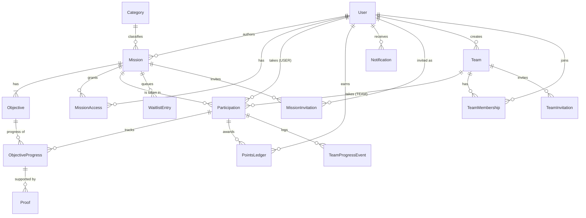

# Data model (PROPOSED draft, frozen in Sprint 0 by task S0-DATAMODEL, owner P3)

Conventions: UUID primary keys (`pgcrypto`), timestamps in UTC (`createdAt`, `updatedAt` on every table unless noted), enums as PostgreSQL enums or checked strings. Every change after the freeze needs the `contract-change` process.

## Entity relationship diagram

## P1 entities

### User (module `users`)
| Field | Type | Constraints |
|---|---|---|
| id | uuid | PK |
| email | string(254) | unique, not null |
| passwordHash | string | not null (bcrypt) |
| nickname | string(30) | unique, not null |
| fullName | string(100) | nullable, private (A-03) |
| bio | string(500) | nullable |
| city | string(80) | nullable |
| avatarUrl | string(500) | nullable |
| role | enum USER \| ADMIN | not null, default USER |
| status | enum ACTIVE \| SUSPENDED | not null, default ACTIVE |
| tokenVersion | int | not null, default 0 (A-02) |

### Category (module `missions`)
| Field | Type | Constraints |
|---|---|---|
| id | uuid | PK |
| name | string(50) | unique, seeded (A-23) |

### Mission (module `missions`)
| Field | Type | Constraints |
|---|---|---|
| id | uuid | PK |
| authorId | uuid | FK User, not null |
| title | string(120) | not null |
| teaser | string(280) | not null |
| description | text | not null |
| categoryId | uuid | FK Category, not null |
| mode | enum ORDINARY \| SECRET_TIMED | not null |
| timeLimitSec | int | required iff SECRET_TIMED, > 0 |
| lat, lng | double | nullable together; -90..90 / -180..180 |
| placeName | string(120) | nullable |
| conditions | text | nullable |
| status | enum DRAFT \| PUBLISHED \| CLOSED \| ARCHIVED | not null, default DRAFT |
| visibility | enum PUBLIC \| RESTRICTED | not null, default PUBLIC |
| participationType | enum INDIVIDUAL \| TEAM | not null, default INDIVIDUAL |
| minTeamSize | int | nullable, ≥ 2 when TEAM |
| maxTeamSize | int | nullable, ≤ 6 |
| minContributors | int | nullable, ≤ minTeamSize |
| maxParticipants | int | nullable = unlimited (A-18) |
| maxAttempts | int | 1..3, default 1 (A-13) |
| publishedAt | timestamp | nullable |
| version | int | optimistic lock (A-06) |

### Objective (module `missions`)
| Field | Type | Constraints |
|---|---|---|
| id | uuid | PK |
| missionId | uuid | FK Mission, not null |
| position | int | unique (missionId, position) |
| title | string(120) | not null |
| description | text | not null |
| verificationType | enum SELF \| ANSWER \| TEXT_PROOF \| IMAGE_PROOF | not null |
| answerHash | string | required iff ANSWER; never serialized |
| points | int | 0..100, default 10 (A-12) |

### MissionAccess (module `missions`)
| Field | Type | Constraints |
|---|---|---|
| missionId | uuid | PK part, FK Mission |
| userId | uuid | PK part, FK User |
| source | enum MANUAL \| INVITE | not null |
| grantedAt | timestamp | not null |

## P2 entities

### Participation (module `participations`)
| Field | Type | Constraints |
|---|---|---|
| id | uuid | PK |
| missionId | uuid | FK Mission, not null |
| participantType | enum USER \| TEAM | not null |
| userId | uuid | FK User, set iff USER |
| teamId | uuid | FK Team, set iff TEAM |
| acceptedById | uuid | FK User, not null |
| status | enum ACTIVE \| SUBMITTED \| COMPLETED \| FAILED \| ABANDONED \| EXPIRED | not null |
| acceptedAt | timestamp | not null |
| deadlineAt | timestamp | nullable (ordinary missions) |
| endedAt | timestamp | nullable |
| attemptNo | int | ≥ 1 |
| pointsAwarded | int | default 0 |
| version | int | optimistic lock |

Partial unique indexes: one ACTIVE or SUBMITTED per (missionId, userId) and per (missionId, teamId).

### ObjectiveProgress (module `participations`)
| Field | Type | Constraints |
|---|---|---|
| id | uuid | PK |
| participationId | uuid | FK, not null |
| objectiveId | uuid | FK, not null; unique (participationId, objectiveId) |
| status | enum PENDING \| SUBMITTED \| APPROVED \| REJECTED | not null |
| contributorUserId | uuid | FK User, nullable |
| wrongAnswers | int | default 0, ≤ 5 (A-10) |
| submittedAt, reviewedAt | timestamp | nullable |
| reviewerId | uuid | FK User, nullable |
| rejectionReason | string(500) | nullable |
| version | int | optimistic lock (A-20) |

### Proof (module `participations`)
| Field | Type | Constraints |
|---|---|---|
| id | uuid | PK |
| objectiveProgressId | uuid | FK, not null |
| type | enum TEXT \| IMAGE | not null |
| text | text | required iff TEXT |
| filePath | string | required iff IMAGE; random name (A-25) |
| mimeType | string | JPEG, PNG or WebP |
| sizeBytes | int | ≤ 5 MB |
| receivedAt | timestamp | server clock (A-09) |

### PointsLedger (module `participations`)
| Field | Type | Constraints |
|---|---|---|
| id | uuid | PK |
| userId | uuid | FK User |
| participationId | uuid | FK; unique (userId, participationId) so points are awarded once |
| points | int | not null |
| reason | string | not null |
| createdAt | timestamp | not null |

### Notification (module `notifications`)
| Field | Type | Constraints |
|---|---|---|
| id | uuid | PK |
| userId | uuid | FK User, indexed |
| type | string | not null |
| payload | jsonb | not null |
| readAt | timestamp | nullable |
| createdAt | timestamp | not null |

### WaitlistEntry (module `participations`)
| Field | Type | Constraints |
|---|---|---|
| id | uuid | PK |
| missionId | uuid | FK Mission |
| userId | uuid | FK User, nullable |
| teamId | uuid | FK Team, nullable |
| status | enum WAITING \| OFFERED \| CLAIMED \| EXPIRED \| LEFT | not null |
| offerExpiresAt | timestamp | nullable (A-18: 15 min) |
| createdAt | timestamp | FIFO order |

## P3 entities

### MissionInvitation (module `invitations`)
| Field | Type | Constraints |
|---|---|---|
| id | uuid | PK |
| missionId | uuid | FK Mission |
| inviterId | uuid | FK User |
| inviteeId | uuid | FK User; unique (missionId, inviteeId) |
| status | enum PENDING \| ACCEPTED \| DECLINED \| REVOKED | not null |

### Team (module `teams`)
| Field | Type | Constraints |
|---|---|---|
| id | uuid | PK |
| name | string(30) | unique, 3–30 chars |
| createdById | uuid | FK User |

### TeamMembership (module `teams`)
| Field | Type | Constraints |
|---|---|---|
| teamId | uuid | PK part, FK |
| userId | uuid | PK part, FK |
| role | enum TEAM_ADMIN \| MEMBER | not null |
| joinedAt | timestamp | not null |
| leftAt | timestamp | nullable |

At most 6 active members per team (A-19).

### TeamInvitation (module `teams`)
| Field | Type | Constraints |
|---|---|---|
| id | uuid | PK |
| teamId | uuid | FK Team |
| inviterId | uuid | FK User |
| inviteeId | uuid | FK User |
| status | enum PENDING \| ACCEPTED \| DECLINED \| REVOKED | not null |

### TeamProgressEvent (module `teams`)
| Field | Type | Constraints |
|---|---|---|
| id | uuid | PK |
| participationId | uuid | FK Participation |
| seq | int | strictly increasing; unique (participationId, seq) (A-21) |
| type | string | not null |
| actorId | uuid | FK User |
| payload | jsonb | not null |
| createdAt | timestamp | not null |
