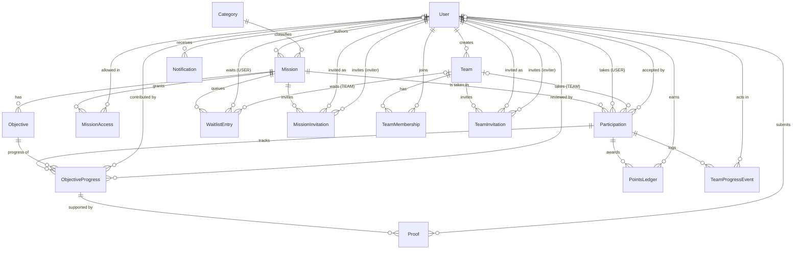

# Data model (FROZEN: task S0-DATAMODEL, owner P3)

Frozen at the end of Sprint 0 with the decisions agreed at the kickoff of 2026-11-23 (review and decisions in [#4](https://github.com/Mynamesdsuper/sidequest-group40/issues/4); minutes in `docs/meetings/2026-11-23.md`). **Every change from now on needs the `contract-change` process.** The codes in brackets (G1, M3, TM1, …) point to the review points in #4.

## Conventions
- **Tables and columns** (G5): Sequelize defaults: plural table names (`Users`, `Missions`, `TeamMemberships`, …), camelCase columns (`underscored: false`). The table name of each entity is given in its heading.
- **Primary keys:** `uuid`, generated by the database, unless stated otherwise.
- **Timestamps:** UTC. Every table has `createdAt` and `updatedAt`, except the append-only tables `PointsLedger`, `Proof` and `TeamProgressEvent`, which have `createdAt` only (G5). Domain times (`acceptedAt`, `deadlineAt`, `receivedAt`, …) come from the server `Clock`, never from the database clock.
- **Enums** (G3): `varchar` + `CHECK (col IN (...))`, no PostgreSQL enum types: their values can then be changed in a normal migration inside a transaction.
- **Case-insensitive uniqueness** (G4): unique index on `lower(col)` for `User.email`, `User.nickname` and `Team.name`; no `citext` extension.
- **Foreign keys** (G1): `Objective → Mission` is `ON DELETE CASCADE` (only DRAFT missions can be deleted, A-05); every other FK is `ON DELETE RESTRICT`. Users are never deleted, only suspended (A-04).
- **Indexes** (G2): PostgreSQL does not index FK columns by itself, so each table lists its indexes. A FK covered by the first column of a primary key or of another index needs no extra index.
- **Optimistic locking:** `version int NOT NULL DEFAULT 0`, managed with the Sequelize `version: true` option (A-06, A-20).
- **Text lengths** (A-26, M5): every text column has a maximum, checked both in the `Validator` and with a `CHECK` / `varchar(n)` in the database.

## Entity relationship diagram

Relations are drawn from the parent to the child; one line per foreign key (G6).

`Mission ||--o{ Objective`: a DRAFT may have no objectives; "at least one objective" is checked when the mission is published (G6).

## P1 entities

### User (`Users`, module `users`)
| Field | Type | Constraints |
|---|---|---|
| id | uuid | PK |
| email | varchar(254) | not null; unique on `lower(email)` |
| passwordHash | varchar(100) | not null (bcrypt, A-02) |
| nickname | varchar(30) | not null; `CHECK nickname ~ '^[A-Za-z0-9_]{3,30}$'`; unique on `lower(nickname)` (U2) |
| fullName | varchar(100) | nullable; private (A-03) |
| bio | varchar(500) | nullable |
| city | varchar(80) | nullable |
| avatarUrl | varchar(500) | nullable |
| role | varchar | `USER` \| `ADMIN`; not null, default `USER` |
| status | varchar | `ACTIVE` \| `SUSPENDED`; not null, default `ACTIVE` |
| tokenVersion | int | not null, default 0 (A-02) |

- **Total points** shown on the public profile (A-03) are derived: `SUM(PointsLedger.points)` for the user. There is no stored total (U1).

### Category (`Categories`, module `missions`)
| Field | Type | Constraints |
|---|---|---|
| id | uuid | PK |
| name | varchar(50) | not null, unique; seeded (A-23) |

### Mission (`Missions`, module `missions`)
| Field | Type | Constraints |
|---|---|---|
| id | uuid | PK |
| authorId | uuid | FK User, not null |
| title | varchar(100) | not null; `CHECK char_length(title) >= 3` (M5) |
| teaser | varchar(280) | not null |
| description | text | not null; `CHECK char_length(description) <= 5000` (M5) |
| categoryId | uuid | FK Category, not null |
| mode | varchar | `ORDINARY` \| `SECRET_TIMED`; not null |
| timeLimitSec | int | required for SECRET_TIMED, optional for ORDINARY (A-11); `CHECK timeLimitSec BETWEEN 60 AND 604800` (1 minute to 7 days) (M1) |
| lat, lng | double | nullable together: `CHECK ((lat IS NULL) = (lng IS NULL))`; lat −90..90, lng −180..180 (M2) |
| placeName | varchar(120) | nullable |
| conditions | varchar(1000) | nullable (M5) |
| status | varchar | `DRAFT` \| `PUBLISHED` \| `CLOSED` \| `ARCHIVED`; not null, default `DRAFT` |
| visibility | varchar | `PUBLIC` \| `RESTRICTED`; not null, default `PUBLIC` |
| participationType | varchar | `INDIVIDUAL` \| `TEAM`; not null, default `INDIVIDUAL` |
| minTeamSize | int | see "Team sizes" below |
| maxTeamSize | int | see "Team sizes" below |
| minContributors | int | see "Team sizes" below |
| maxParticipants | int | nullable = unlimited (A-18); otherwise `>= 1` (M4). For TEAM missions it counts teams |
| maxAttempts | int | not null, default 1; `CHECK maxAttempts BETWEEN 1 AND 3` (A-13) |
| publishedAt | timestamp | nullable; set on DRAFT → PUBLISHED |
| version | int | optimistic lock (A-06) |

- **Time limit** (M1): `CHECK (mode <> 'SECRET_TIMED' OR timeLimitSec IS NOT NULL)`. An ORDINARY mission with no time limit never expires (A-11).
- **Team sizes** (M3; meaning of `maxTeamSize` added to A-20 by contract-change #72):
  - INDIVIDUAL: `minTeamSize`, `maxTeamSize` and `minContributors` are all NULL.
  - TEAM: all three not null, with `1 <= minTeamSize <= maxTeamSize <= 6` (A-19 caps a team at 6) and `1 <= minContributors <= minTeamSize`.
  - `minTeamSize`: members the team needs to accept (A-20). `maxTeamSize`: the most team members who can take part in this mission. It is checked at acceptance, and when a member joins a team that has an active participation in the mission (the join is refused if it would exceed the maximum).
- **Search** (M6): keyword with `ILIKE` on the fields listed in A-24; no `pg_trgm` and no full-text search (no extension to justify).
- **Indexes:** `(status, visibility)`, `categoryId`, `authorId`, `(lat, lng)` for the map bounding box (M6).

### Objective (`Objectives`, module `missions`)
| Field | Type | Constraints |
|---|---|---|
| id | uuid | PK |
| missionId | uuid | FK Mission, not null, `ON DELETE CASCADE` |
| position | int | not null, `>= 1`; `UNIQUE (missionId, position)` |
| title | varchar(120) | not null |
| description | varchar(2000) | not null (M5) |
| verificationType | varchar | `SELF` \| `ANSWER` \| `TEXT_PROOF` \| `IMAGE_PROOF`; not null |
| answerHash | varchar(100) | `CHECK ((verificationType = 'ANSWER') = (answerHash IS NOT NULL))`; never serialized (O2) |
| points | int | not null, default 10; `CHECK points BETWEEN 0 AND 100` (A-12) |

- **Editing** (O1): while the mission is fully editable (A-06), its objectives are replaced as a whole in one transaction (delete and insert), so `UNIQUE (missionId, position)` never conflicts during a reorder. After the first acceptance the objectives are locked.
- **Answers** (O2): `answerHash` is the bcrypt hash of the normalized answer: trimmed, inner whitespace collapsed to one space, lowercased (A-10). Every attempt is normalized the same way and compared with `bcrypt.compare`. A database dump does not reveal the answers.
- **Indexes:** none extra (`missionId` is covered by the unique index).

### MissionAccess (`MissionAccesses`, module `missions`)
| Field | Type | Constraints |
|---|---|---|
| missionId | uuid | PK part, FK Mission |
| userId | uuid | PK part, FK User |
| source | varchar | PK part; `MANUAL` \| `INVITE` |
| grantedAt | timestamp | not null |

- **Primary key** `(missionId, userId, source)` (MA1): revoking an invitation removes only the `INVITE` row, so a `MANUAL` grant survives. A user can view a RESTRICTED mission when at least one row exists (A-16).
- Rows are written only through `MissionAccessPort.grant/revoke` (S0-API).
- **Indexes:** `userId`.

## P2 entities

### Participation (`Participations`, module `participations`)
| Field | Type | Constraints |
|---|---|---|
| id | uuid | PK |
| missionId | uuid | FK Mission, not null |
| participantType | varchar | `USER` \| `TEAM`; not null |
| userId | uuid | FK User; set iff `USER` |
| teamId | uuid | FK Team; set iff `TEAM` |
| acceptedById | uuid | FK User, not null (the user, or the TEAM_ADMIN who accepted for the team) |
| status | varchar | `ACTIVE` \| `SUBMITTED` \| `COMPLETED` \| `FAILED` \| `ABANDONED` \| `EXPIRED`; not null |
| acceptedAt | timestamp | not null (server `Clock`) |
| deadlineAt | timestamp | nullable (no time limit) (A-08) |
| endedAt | timestamp | nullable; set when the participation reaches a final state |
| attemptNo | int | not null, `>= 1` (A-13) |
| version | int | optimistic lock |

- **Participant** (P1): `CHECK ((participantType = 'USER' AND userId IS NOT NULL AND teamId IS NULL) OR (participantType = 'TEAM' AND teamId IS NOT NULL AND userId IS NULL))`.
- **Points** (P4): there is no `pointsAwarded` column; points live only in `PointsLedger`.
- **A-20 rule** (P2): "not individually and through a team, nor through two teams" involves `TeamMemberships`, so it cannot be an index. The `participations` service checks it inside the same transaction and mission row lock (`SELECT … FOR UPDATE`) used for capacity (A-18), and answers 409 `ALREADY_PARTICIPATING`. **Who plays for a team** is the team's current members: a member who leaves loses access and keeps their contributions; a member who joins later takes part (within `maxTeamSize`), unless they already take part in the same mission (409 `ALREADY_PARTICIPATING`).
- **Indexes** (P3):
  - `UNIQUE (missionId, userId, attemptNo)` and `UNIQUE (missionId, teamId, attemptNo)`;
  - partial unique: one `ACTIVE` or `SUBMITTED` participation per `(missionId, userId)` and per `(missionId, teamId)`;
  - `(missionId, status)` for the capacity count;
  - partial `(deadlineAt) WHERE status = 'ACTIVE'` for the expiry sweeper (A-08);
  - `userId`, `teamId`, `acceptedById`.

### ObjectiveProgress (`ObjectiveProgresses`, module `participations`)
| Field | Type | Constraints |
|---|---|---|
| id | uuid | PK |
| participationId | uuid | FK Participation, not null |
| objectiveId | uuid | FK Objective, not null; `UNIQUE (participationId, objectiveId)` |
| status | varchar | `PENDING` \| `SUBMITTED` \| `APPROVED` \| `REJECTED`; not null, default `PENDING` |
| contributorUserId | uuid | FK User, nullable: who submitted the accepted answer or proof |
| wrongAnswers | int | not null, default 0; `CHECK wrongAnswers BETWEEN 0 AND 5` (A-10) |
| submittedAt | timestamp | nullable |
| reviewedAt | timestamp | nullable |
| reviewerId | uuid | FK User, nullable; `CHECK ((reviewerId IS NULL) = (reviewedAt IS NULL))` |
| rejectionReason | varchar(500) | nullable |
| version | int | optimistic lock (A-20) |

- One `PENDING` row per objective is created in the acceptance transaction (OP1).
- **Indexes:** `objectiveId`, `contributorUserId`, `reviewerId` (`participationId` is covered by the unique index).

### Proof (`Proofs`, module `participations`, append-only)
| Field | Type | Constraints |
|---|---|---|
| id | uuid | PK |
| objectiveProgressId | uuid | FK ObjectiveProgress, not null |
| submittedById | uuid | FK User, not null: who sent this proof (PR1) |
| type | varchar | `TEXT` \| `IMAGE`; not null |
| text | varchar(2000) | required iff `TEXT` (M5) |
| filePath | varchar(255) | required iff `IMAGE`; unique; random name (A-25) |
| mimeType | varchar | required iff `IMAGE`; `image/jpeg` \| `image/png` \| `image/webp` |
| sizeBytes | int | required iff `IMAGE`; `CHECK sizeBytes BETWEEN 1 AND 5242880` (5 MB) |
| receivedAt | timestamp | not null; server `Clock` (A-09) |

- **Consistency** (PR1): `CHECK ((type = 'TEXT' AND text IS NOT NULL AND filePath IS NULL) OR (type = 'IMAGE' AND filePath IS NOT NULL AND mimeType IS NOT NULL AND sizeBytes IS NOT NULL AND text IS NULL))`.
- A resubmission after a rejection adds a new row; the old proofs stay.
- **Indexes:** `objectiveProgressId`, `submittedById`.

### PointsLedger (`PointsLedgers`, module `participations`, append-only)
| Field | Type | Constraints |
|---|---|---|
| id | uuid | PK |
| userId | uuid | FK User, not null |
| participationId | uuid | FK Participation, not null; `UNIQUE (userId, participationId)` so points are awarded once (A-12) |
| points | int | not null |
| reason | varchar(100) | not null |

- The single source of points (U1, P4): one row per user who receives points when a participation becomes COMPLETED; in a team mission, one row per member who contributed at least one approved objective (A-12).
- **Indexes:** `userId` (for `SUM`; covered by the unique index), `participationId`.

### Notification (`Notifications`, module `notifications`)
| Field | Type | Constraints |
|---|---|---|
| id | uuid | PK |
| userId | uuid | FK User, not null |
| type | varchar | not null; `CHECK` against the list in `docs/api/realtime-events.md` (A-15), without the optional `participation.time.warning` (N1) |
| payload | jsonb | not null |
| readAt | timestamp | nullable |

- **Indexes** (N1): `(userId, createdAt DESC)` for pagination; partial `(userId) WHERE readAt IS NULL` for the unread badge.

### WaitlistEntry (`WaitlistEntries`, module `participations`)
| Field | Type | Constraints |
|---|---|---|
| id | uuid | PK |
| missionId | uuid | FK Mission, not null |
| participantType | varchar | `USER` \| `TEAM`; not null; same `CHECK` as `Participation` (W1) |
| userId | uuid | FK User; set iff `USER` |
| teamId | uuid | FK Team; set iff `TEAM` |
| status | varchar | `WAITING` \| `OFFERED` \| `CLAIMED` \| `EXPIRED` \| `LEFT`; not null |
| offerExpiresAt | timestamp | `CHECK (status <> 'OFFERED' OR offerExpiresAt IS NOT NULL)`; 15 minutes (A-18) |

- **FIFO order:** `(createdAt, id)`, so equal timestamps have a stable order (W1).
- **Indexes** (W1):
  - partial unique: one `WAITING` or `OFFERED` entry per `(missionId, userId)` and per `(missionId, teamId)`;
  - `(missionId, status, createdAt)` for the next entry;
  - `(status, offerExpiresAt)` for the offer-expiry sweeper;
  - `userId`, `teamId`.

## P3 entities

### MissionInvitation (`MissionInvitations`, module `invitations`)
| Field | Type | Constraints |
|---|---|---|
| id | uuid | PK |
| missionId | uuid | FK Mission, not null |
| inviterId | uuid | FK User, not null |
| inviteeId | uuid | FK User, not null; `UNIQUE (missionId, inviteeId)` |
| status | varchar | `PENDING` \| `ACCEPTED` \| `DECLINED` \| `REVOKED`; not null |
| respondedAt | timestamp | nullable; set on ACCEPTED or DECLINED (I1) |

- Only for RESTRICTED missions; one row per (mission, invitee), reopened as `PENDING` on a new invitation (A-17).
- **Accept and revoke at the same time** (I1): every transition is a conditional `UPDATE … WHERE id = :id AND status = 'PENDING'` (for revoke: `status IN ('PENDING', 'ACCEPTED')`). The operation that updates no row gets 409 `INVITATION_NOT_PENDING`.
- **Indexes:** `(inviteeId, status)`, `inviterId` (`missionId` is covered by the unique index).

### Team (`Teams`, module `teams`)
| Field | Type | Constraints |
|---|---|---|
| id | uuid | PK |
| name | varchar(30) | not null; `CHECK char_length(name) BETWEEN 3 AND 30`; unique on `lower(name)` among active teams: partial unique index `WHERE disbandedAt IS NULL` (T1) |
| createdById | uuid | FK User, not null |
| disbandedAt | timestamp | nullable (T1) |

- A disbanded team is kept, because its participations reference it (A-19). Its name can be reused by a new team.
- **Indexes:** `createdById`.

### TeamMembership (`TeamMemberships`, module `teams`)
| Field | Type | Constraints |
|---|---|---|
| id | uuid | PK (TM1) |
| teamId | uuid | FK Team, not null |
| userId | uuid | FK User, not null |
| role | varchar | `TEAM_ADMIN` \| `MEMBER`; not null |
| joinedAt | timestamp | not null |
| leftAt | timestamp | nullable |

- **Rejoining** (TM1): a member who leaves keeps the old row (history) and gets a new row on rejoining. Partial unique `(teamId, userId) WHERE leftAt IS NULL`: one active membership per user and team.
- **One active TEAM_ADMIN**: partial unique `(teamId) WHERE role = 'TEAM_ADMIN' AND leftAt IS NULL`.
- **At most 6 active members** (A-19): checked by the `teams` service under a lock on the `Team` row (`SELECT … FOR UPDATE`).
- **Indexes:** `teamId`, `userId` (the partial unique indexes cover only active rows).

### TeamInvitation (`TeamInvitations`, module `teams`)
| Field | Type | Constraints |
|---|---|---|
| id | uuid | PK |
| teamId | uuid | FK Team, not null |
| inviterId | uuid | FK User, not null |
| inviteeId | uuid | FK User, not null; `UNIQUE (teamId, inviteeId)` (TI1) |
| status | varchar | `PENDING` \| `ACCEPTED` \| `DECLINED` \| `REVOKED`; not null |
| respondedAt | timestamp | nullable |

- One row per (team, invitee), reopened as `PENDING` on a new invitation, as in A-17 (TI1). Transitions use the same conditional `UPDATE` as `MissionInvitation` (I1). Accepting re-checks the 6-member cap under the `Team` row lock.
- **Indexes:** `(inviteeId, status)`, `inviterId` (`teamId` is covered by the unique index).

### TeamProgressEvent (`TeamProgressEvents`, module `teams`, append-only)
| Field | Type | Constraints |
|---|---|---|
| id | uuid | PK |
| participationId | uuid | FK Participation, not null |
| seq | int | not null; `CHECK seq >= 1`; `UNIQUE (participationId, seq)` (A-21) |
| type | varchar(50) | not null; checked against the list of team events in `docs/api/realtime-events.md` |
| actorId | uuid | FK User, nullable (NULL for system events such as expiry) |
| payload | jsonb | not null |

- **How `seq` is generated** (TPE1): in the transaction of the state change, `SELECT … FOR UPDATE` on the participation row, then `max(seq) + 1`. `UNIQUE (participationId, seq)` is the safety net. The event is emitted on Socket.IO only after the commit (A-21). No extra column on `Participations`.
- **Indexes:** `actorId` (`participationId` is covered by the unique index).

## State transitions

Every transition not listed here is refused by the owning service (409). They are the source for the state diagrams of DOC-STATE.

### Mission (A-05, A-04)
| From | To | When |
|---|---|---|
| DRAFT | PUBLISHED | the author publishes; at least one objective; sets `publishedAt` |
| PUBLISHED | CLOSED | the author or an admin closes it, or the author is suspended (A-04); running participations continue |
| CLOSED | ARCHIVED | the author or an admin archives it; only if no participation is ACTIVE or SUBMITTED |

A DRAFT can be deleted (not a state). An ARCHIVED mission is never reopened; the author can duplicate it as a new DRAFT (A-13).

### Participation (A-08 … A-11, A-14)
| From | To | When |
|---|---|---|
| (none) | ACTIVE | acceptance (or the claim of a waitlist offer, A-18) |
| ACTIVE | SUBMITTED | every objective is submitted and at least one waits for the author's review |
| ACTIVE | COMPLETED | every objective is approved (for example all SELF or ANSWER) and, for teams, at least `minContributors` distinct contributors (A-20) |
| SUBMITTED | COMPLETED | the last review approves and the conditions above hold |
| SUBMITTED | ACTIVE | a proof is rejected while time remains: it can be resubmitted (A-10) |
| SUBMITTED | FAILED | a proof is rejected after the deadline (A-11) |
| ACTIVE | FAILED | the 5 wrong answers of an objective are used up (A-10) |
| ACTIVE | ABANDONED | explicit, confirmed withdrawal; it counts as an attempt (A-14) |
| ACTIVE | EXPIRED | `deadlineAt + 10 s` passed with objectives still unsubmitted (A-08, A-09) |

COMPLETED, FAILED, ABANDONED and EXPIRED are final and set `endedAt`. A new attempt is a new row with `attemptNo + 1` (A-13). COMPLETED writes the `PointsLedger` rows in the same transaction (A-12).

### ObjectiveProgress (A-10)
| From | To | When |
|---|---|---|
| PENDING | APPROVED | SELF objective submitted, or correct ANSWER |
| PENDING | PENDING | wrong ANSWER: `wrongAnswers + 1` |
| PENDING | SUBMITTED | TEXT_PROOF or IMAGE_PROOF sent |
| SUBMITTED | APPROVED / REJECTED | the author reviews (also after the deadline, A-09) |
| REJECTED | SUBMITTED | a new proof while time remains |

### WaitlistEntry (A-18)
| From | To | When |
|---|---|---|
| WAITING | OFFERED | a slot frees up and the entry is first in FIFO order; `offerExpiresAt = now + 15 min` |
| OFFERED | CLAIMED | the user (or the TEAM_ADMIN) claims the offer: this is the acceptance |
| OFFERED | EXPIRED | the hold expires; the offer moves to the next entry |
| WAITING / OFFERED | LEFT | the user leaves the waitlist |

### MissionInvitation (A-17) and TeamInvitation (A-19)
| From | To | When |
|---|---|---|
| PENDING | ACCEPTED / DECLINED | the invitee responds |
| PENDING | REVOKED | the inviter revokes |
| ACCEPTED | REVOKED | mission invitations only: removes the `INVITE` access; a running participation continues |
| DECLINED / REVOKED | PENDING | a new invitation reopens the row |

## Not in the database
- **Online presence** (A-21) is kept in memory by the Socket.IO gateway, not in a table.
- **"5 minutes left" notification:** not built now (not required by the brief), so there is no `reminderSentAt` column. Adding it later needs a contract-change.
