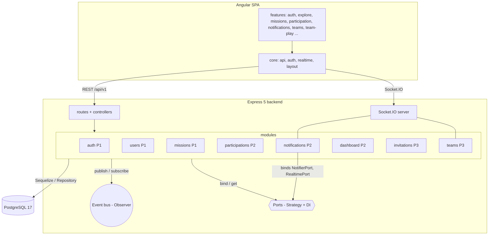
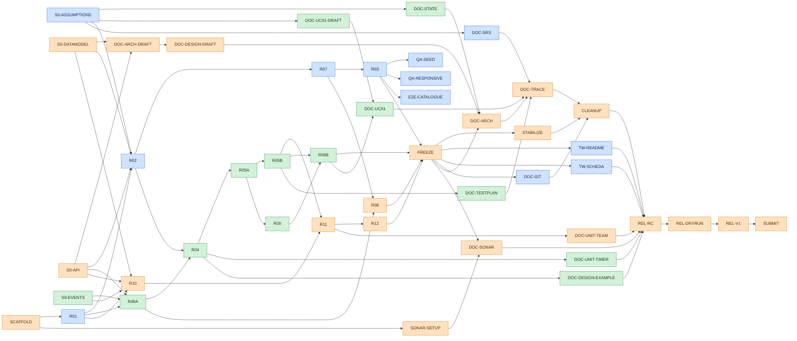
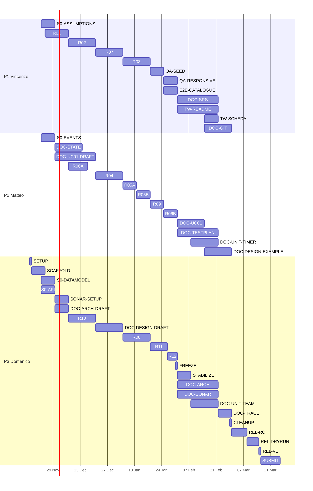

# SideQuest – Group 40 – Master Plan

Integrated project INGSW + TECWEB · Università degli Studi di Napoli Federico II · A.A. 2026/27

Generated from `docs/plan/tasks.json` and the setup prompt (`docs/plan/setup-prompt.md`). Task IDs, dates and dependencies are authoritative in `tasks.json`; the live status of each task is on GitHub (`npm run deps -- --all`).

# 1. Project at a glance

| Item | Value |
|---|---|
| Course exams | Ingegneria del Software (INGSW) + Tecnologie Web (TECWEB), one integrated product |
| Group | **40** (3 members) |
| Packages | The last digit of the group ID is 0, and 0 mod 5 = 0, so the first package is **A**. With 3 members: **A (R07–R09) + B (R10–R12)**, plus the mandatory core **R01–R06** |
| Delivery type | **Early delivery** (by 31/03/2027): requirements **R01–R12** |
| Project type | **Integrated**: one single product evaluated by both exams |
| Repository | `https://github.com/Mynamesdsuper/sidequest-group40` (public); the URL is posted in the Teams assignment |
| Status | Setup done (no code). Next: task **SCAFFOLD** (code scaffold, P3, due 24 Nov 2026) |

## Internal and official deadlines

| Date | Event |
|---|---|
| Tue 17 Nov 2026 | Setup done (repo, plan, guides, issues; no code) |
| Tue 24 Nov 2026 | Code scaffold merged (task SCAFFOLD, P3) |
| Sun 29 Nov 2026 | Sprint 0 done: assumptions, data model, API and event contracts frozen |
| **Sun 31 Jan 2027** | **Feature freeze: all of R01–R12 merged into `develop`** |
| 1–7 Feb 2027 | Stabilization buffer (bug fixes only; R12 may close here at the latest) |
| Sun 28 Feb 2027 | All documentation complete |
| Mon 15 Mar 2027 | Release `v1.0.0` on `main` |
| Thu 25 Mar 2027 | Submission on Teams (the official hard deadline is 31 Mar 2027) |

# 2. The team and their responsibilities

| Role | Name | Student ID | GitHub | Requirements | Backend modules | Frontend features | Reviewed by | Reviews |
|---|---|---|---|---|---|---|---|---|
| **P1** | Vincenzo Pio Lubrano | N86005417 | `vincenzolubrano05` | R01, R02, R03, R07 | `auth`, `users`, `missions` | `auth`, `profile`, `admin`, `missions`, `explore`, `shared/map` | P2 | P3 |
| **P2** | Matteo Marino | N86005461 | `reverinn` | R04, R05, R06, R09 | `participations`, `notifications`, `dashboard` | `participation`, `waitlist`, `notifications`, `dashboard`, `core/realtime` | P3 | P1 |
| **P3** | Domenico Panaro (admin, coordinator) | N86005622 | `Mynamesdsuper` | R08, R10, R11, R12, SCAFFOLD | `invitations`, `teams` | `invitations`, `teams`, `team-play` | P1 | P2 |

**INGSW chapters:** P1 = SRS (glossary, actors and use case diagram, personas, NFR) and Git analysis; P2 = UC-01 and mockups, test plan, `TimerPolicy` unit tests, design example, state diagram; P3 = architecture and design, class/ER/sequence diagrams, Sonar report, `TeamProgressReducer` unit tests, traceability and PDF assembly.
**TECWEB:** P1 = README, one-page summary sheet, E2E catalogue verification; every member writes the E2E specs of their own requirements.
**E2E tests:** P1 = E2E-01..04, P2 = E2E-05..08, P3 = E2E-09..12.

**Everyone must be able to explain the whole project** at the exam (brief §3): the REL-DRYRUN task rehearses cross-module knowledge.

# 3. Requirements R01–R12

| Req | Title | Owner | Tasks |
|---|---|---|---|
| R01 | Accounts, access, profile | P1 | R01 |
| R02 | Mission creation and publication | P1 | R02 |
| R03 | Exploration and search | P1 | R03 |
| R04 | Acceptance and timed missions | P2 | R04 |
| R05 | Progress, proofs, completion | P2 | R05A, R05B |
| R06 | Personal area and live notifications | P2 | R06A, R06B |
| R07 | Restricted visibility (package A) | P1 | R07 |
| R08 | Invitations (package A) | P3 | R08 |
| R09 | Capacity and waitlist (package A) | P2 | R09 |
| R10 | Exploration teams (package B) | P3 | R10 |
| R11 | Team participation (package B) | P3 | R11 |
| R12 | Live cooperative updates (package B) | P3 | R12 |

Full paraphrase: `docs/reference/requirements.md`. Domain assumptions A-01..A-26 (PROPOSED, ratified in Sprint 0): `docs/decisions/assumptions.md`.

# 4. Tech stack and rationale

| Area | Decision |
|---|---|
| Repo | Monorepo: `backend/`, `frontend/`, `e2e/`, `docs/`, `scripts/`, `docker/`, `.github/` |
| Backend | Node.js 22 LTS, TypeScript (strict), Express 5, Sequelize 6 + `pg`, Umzug migrations, hand-written validation, JWT, bcryptjs, Socket.IO 4, multer, helmet, express-rate-limit, swagger-ui-express |
| Database | PostgreSQL 17 in Docker (`sidequest_dev`, `sidequest_test`) |
| Frontend | Latest stable Angular (standalone, signals, SCSS, no SSR), **no UI component library**, hand-written modern CSS, Leaflet + OpenStreetMap, `socket.io-client` |
| Tests | Jest + ts-jest + supertest; Playwright (desktop + mobile viewport) |
| Quality | ESLint + Prettier; SonarCloud on the backend |
| API | REST under `/api/v1`, JSON, uniform error format, OpenAPI 3.1 fragments per module served at `/api/docs` |
| Realtime | Socket.IO on the same HTTP server, JWT in the handshake |
| Architecture | Layered monolith split into modules; modules talk only through `index.ts`, ports (**Strategy** + **Dependency Injection**) or domain events (**Observer**); data access per module = **Repository** |

## 4.1 Alignment with what was taught

Rule: **use what was taught by default; anything else needs a written rationale every member can repeat at the exam** (ADR 0006).

**Taught and used as taught:**
- Node.js 22 and npm.
- Express 5: routers, middleware, async error handling, error-handler middleware, `express.json`, `cors`, `morgan`, `dotenv` with `.env` + `.env.example`.
- Sequelize 6: models, associations, transactions.
- REST design rules: plural nouns for collections, controller resources as verbs, filtering and pagination in the query string, correct status codes, no trailing slash, lowercase-hyphen URIs.
- JWT in the Authorization header with `jsonwebtoken` (secret in `TOKEN_SECRET`) plus authorization middleware.
- OpenAPI.
- On the client: `fetch`, Promises, async/await, `localStorage`, ES classes and modules; modern responsive CSS.
- INGSW: Git, Docker, GitHub Actions, SonarCloud; Cockburn use cases, personas, mockups; UML class, sequence and state diagrams; patterns Singleton, Adapter, Decorator, Composite, Observer, Strategy, Repository, MVC, Dependency Injection; layered and monolithic architectures.
- Leaflet + OpenStreetMap.

**Not taught (or not yet), kept with rationale:**

| Choice | Rationale |
|---|---|
| TypeScript | Static types make module contracts between 3 developers explicit and checked at compile time. Angular requires TypeScript anyway. Typed classes and interfaces map 1:1 to the UML class diagram. |
| Socket.IO | R06/R12 need prompt updates; R12 needs ordering and reconnection handling. Socket.IO adds rooms, automatic reconnection and acks over WebSocket. Polling was considered and rejected for R12 latency and server load. |
| Umzug migrations instead of `sequelize.sync()` | `sync()` suits one developer. With three people changing the schema, versioned migrations are reviewable, ordered and reproducible on every machine and in CI. |
| bcryptjs | Credentials must be protected: passwords are never stored in clear text (the lecture demo did so only for simplicity). |
| helmet, express-rate-limit | Cheap standard hardening (security headers; brute-force protection on login and register). |
| Hand-written validation | Taught concepts only: a small `Validator` class with rules, used by a `validate()` middleware. No extra dependency. |
| Jest + supertest, Playwright | The brief requires xUnit-family unit tests and ≥10 automated E2E tests; no testing tool has been covered yet. Playwright supports several browser contexts (needed for live-update tests). **Re-check when the course covers testing; switch if prescribed.** |
| Angular | The SPA framework is announced for the next lectures; a course slide names "Angular App". **Re-check when the course covers SPAs.** |
| Swagger UI | Required "documented APIs"; it only displays the OpenAPI spec. |

# 5. Architecture



**Ports:** `NotifierPort` and `RealtimePort` (bound by P2/R06A), `ParticipationQueryPort` (P2, R04/R09), `MissionAccessPort` (P1, R07), `TeamMembershipPort` (P3, R10). Each has a safe null-object default so a module can be built before the others exist.

**Ownership map:** see section 2 and `.github/CODEOWNERS` (every path has an owner and a reviewer buddy). Modules from `docs/design/module-contracts.md`; data model in `docs/design/data-model.md`.

# 6. Repository structure (target, after SCAFFOLD)

```text
sidequest-group40/
├── PROGRESS.md              running log of every change (per member section)
├── CLAUDE.md                rules for Claude Code sessions
├── CONTRIBUTING.md          git workflow, reviews, DoD
├── README.md
├── package.json             planning/PDF scripts (+ setup:dev after SCAFFOLD)
├── backend/                 [SCAFFOLD] Express 5 + TypeScript
│   └── src/ modules/{auth,users,missions,participations,notifications,dashboard,invitations,teams}/
│        shared/{config,validation,db,errors,http,clock,events,ports,realtime,openapi,testing}/
│        db/{migrations,seeds}/
├── frontend/                [SCAFFOLD] Angular
│   └── src/app/ core/{api,auth,realtime,layout}/  shared/{ui,map}/  features/<feature>/
├── e2e/                     [SCAFFOLD] Playwright (tests/, fixtures/)
├── docker/ + docker-compose*.yml   [SCAFFOLD]
├── scripts/                 deps.mjs, create-issues.mjs, validate-plan.mjs, render-pdf.mjs
├── docs/
│   ├── plan/                PLAN.md, tasks.json, team.json, PDFs, setup-prompt.md
│   ├── guides/              P1/P2/P3 personal guides (+ PDFs)
│   ├── reference/           requirements.md
│   ├── decisions/           assumptions.md, adr/0001..0006
│   ├── design/              data-model.md, module-contracts.md, scaffold-spec.md
│   ├── api/                 realtime-events.md
│   ├── ingsw/               INGSW document chapters (created by the DOC tasks)
│   ├── tecweb/              e2e-catalogue.md (+ summary sheet later)
│   ├── uml/                 PlantUML drafts (DOC tasks)
│   └── meetings/            weekly sync notes
└── .github/                 CODEOWNERS, templates, workflows
```

Folders marked **[SCAFFOLD]** do not exist yet: they are created by the task SCAFFOLD from `docs/design/scaffold-spec.md`.

# 7. Collaboration rules

- **Git workflow:** `main` (releases only) + `develop` (integration, default) + short-lived branches `feature/<task-id>-<slug>`, `docs/<task-id>-<slug>`, `fix/<task-id>-<slug>`, `chore/<slug>`. Squash-merge into `develop`; merge commits for release PRs. Conventional Commits with the module as scope. Commit with your own identity.
- **Ownership:** edit only files you own (CODEOWNERS). Branch protection: PR required, 1 approval, code-owner review, status checks, no force pushes, admins included.
- **Gating rule:** a task may be started only when every task in its `blockedBy` list is DONE (issue closed by a PR merged into `develop`). `npm run deps -- <ID>` checks it. If a blocker is more than 3 days late, raise it at the weekly sync; the owner may merge a minimal vertical slice first.
- **Contract-change process:** shared code and contracts change only through a `contract-change` issue agreed by all three, then a PR reviewed by both others.
- **Reviews:** P1 ← P2, P2 ← P3, P3 ← P1, within 48 hours.
- **Definition of Done (every R task):**
  - Backend: migration(s), models, domain classes, service, controller, routes; input validation with the shared `Validator`; authorization in the service layer; meaningful error codes; domain events emitted; OpenAPI fragment updated (`x-status: done`).
  - Frontend: responsive at 360 px and desktop; loading, empty and error states; no secret data in responses where forbidden.
  - Tests: unit tests for domain classes; integration tests with supertest, **at least one authorization-negative case**; the assigned E2E specs pass in CI.
  - Seeds updated so the feature is demonstrable without physical travel.
  - `PROGRESS.md` updated after every step, final "DONE" entry linking the PR.
  - Docs updated: module README, traceability row, README features table.
  - CI green, PR approved by the reviewer buddy, squash-merged with `Closes #<issue>`.
- **Weekly sync:** 30 minutes every Monday: what got merged, open blockers (`npm run deps -- --all`), contract-change requests. Notes in `docs/meetings/YYYY-MM-DD.md`.
- **Progress log:** every progress step gets an entry in your section of `PROGRESS.md`, committed with the work (format in `CLAUDE.md` §9b).

<div class="landscape">

# 8. Dependency graph

Every task of `tasks.json`, coloured by owner (**blue = P1, green = P2, orange = P3**). `SETUP` (done) is omitted and redundant (transitive) edges are not drawn, so the graph shows only the direct gating relations that matter.



</div>

# 9. Timeline



## Milestones

| ID | Title | Due | Tasks |
|---|---|---|---|
| M0 | Setup | 2026-11-17 | SETUP |
| M1 | Sprint 0 – Analysis and contracts | 2026-11-29 | SCAFFOLD, S0-ASSUMPTIONS, S0-DATAMODEL, S0-API, S0-EVENTS |
| M2 | Foundations (R01) | 2026-12-06 | R01, SONAR-SETUP, DOC-ARCH-DRAFT |
| M3 | Missions, notifications, teams | 2026-12-20 | DOC-STATE, DOC-UC01-DRAFT, R02, R06A, R10 |
| M4 | Holiday sprint | 2027-01-03 | R07, R04, DOC-DESIGN-DRAFT |
| M5 | Core gameplay | 2027-01-17 | R03, R05A, R05B, R08 |
| M6 | Feature freeze | 2027-01-31 | R09, R11, QA-SEED, R06B, R12, QA-RESPONSIVE, E2E-CATALOGUE, FREEZE |
| M7 | Documentation and quality | 2027-02-28 | STABILIZE, DOC-SRS, TW-README, TW-SCHEDA, DOC-GIT, DOC-UC01, DOC-TESTPLAN, DOC-UNIT-TIMER, DOC-DESIGN-EXAMPLE, DOC-ARCH, DOC-SONAR, DOC-UNIT-TEAM, DOC-TRACE, CLEANUP |
| M8 | Release and submission | 2027-03-25 | REL-RC, REL-DRYRUN, REL-V1, SUBMIT |

# 10. Step-by-step plan per person

## P1 – Vincenzo Pio Lubrano

1. **S0-ASSUMPTIONS** – Ratify domain assumptions A-01..A-26
   - Dates: 2026-11-23 → 2026-11-29 (milestone M1)
   - Blocked by: SETUP
   - Deliverables: Review every row A-01..A-26 with the team (Sprint 0 call); Turn each row into ACCEPTED, or change it through a PR with the reason
   - You hand over to: DOC-STATE (P2), DOC-UC01-DRAFT (P2)
2. **R01** – R01 Accounts, authentication, profile, admin
   - Dates: 2026-11-25 → 2026-12-06 (milestone M2)
   - Blocked by: SETUP, SCAFFOLD
   - Deliverables: Register, login, logout with email + password (bcrypt); JWT HS256 with `tokenVersion`; logout/suspension/password change increment it (A-02); Rate limiting on login and register
   - You hand over to: R06A (P2), R10 (P3), FREEZE (P3)
3. **R02** – R02 Mission creation, editing, publication, map picker
   - Dates: 2026-12-07 → 2026-12-20 (milestone M3)
   - Blocked by: R01, S0-ASSUMPTIONS, S0-DATAMODEL, S0-API
   - Deliverables: Create/edit missions with title, teaser, description, category, objectives, optional place, ORDINARY or SECRET_TIMED mode, conditions; Lifecycle DRAFT → PUBLISHED → CLOSED → ARCHIVED; only DRAFT can be deleted (A-05)
   - You hand over to: R04 (P2), FREEZE (P3)
4. **R07** – R07 Restricted visibility and access enforcement
   - Dates: 2026-12-21 → 2027-01-03 (milestone M4)
   - Blocked by: R02
   - Deliverables: PUBLIC/RESTRICTED visibility; `MissionAccess` allow-list; bind `MissionAccessPort`; Unauthorized users get **404** from detail, objectives, proofs and every related endpoint; mission absent from list, map and search (A-16)
   - You hand over to: R08 (P3), FREEZE (P3)
5. **R03** – R03 Exploration and search: list, map, filters, secret preview
   - Dates: 2027-01-04 → 2027-01-17 (milestone M5)
   - Blocked by: R02, R07
   - Deliverables: List and interactive map for guests and users; search by keyword, category, availability, mode, participation type, bounding box (A-24); Availability read through `ParticipationQueryPort` (AVAILABLE until R09 binds it)
   - You hand over to: FREEZE (P3)
6. **QA-SEED** – Consolidated demo dataset covering every feature
   - Dates: 2027-01-18 → 2027-01-24 (milestone M6)
   - Blocked by: R03
   - Deliverables: Consolidated demo dataset covering every feature
   - You hand over to: nobody directly (internal or later gating)
7. **QA-RESPONSIVE** – Responsive and error-handling audit of all screens (issues filed to owners)
   - Dates: 2027-01-25 → 2027-01-31 (milestone M6)
   - Blocked by: R03
   - Deliverables: Responsive and error-handling audit of all screens (issues filed to owners)
   - You hand over to: nobody directly (internal or later gating)
8. **E2E-CATALOGUE** – Verify the >=10 E2E catalogue is complete, non-duplicate and green in CI
   - Dates: 2027-01-25 → 2027-01-31 (milestone M6)
   - Blocked by: R03
   - Deliverables: All 12 scenarios of `docs/tecweb/e2e-catalogue.md` exist, are non-duplicate and green in CI; At least one negative/authorization case present (E2E-04 and E2E-12)
   - You hand over to: nobody directly (internal or later gating)
9. **DOC-SRS** – SRS: glossary, actors, use case diagram (VP), personas, NFR and domain requirements, assumptions rationale
   - Dates: 2027-02-01 → 2027-02-21 (milestone M7)
   - Blocked by: S0-ASSUMPTIONS
   - Deliverables: SRS: glossary, actors, use case diagram (VP), personas, NFR and domain requirements, assumptions rationale
   - You hand over to: DOC-TRACE (P3)
10. **TW-README** – Final README (TECWEB B.3)
   - Dates: 2027-02-01 → 2027-02-21 (milestone M7)
   - Blocked by: FREEZE
   - Deliverables: Final README (TECWEB B.3)
   - You hand over to: REL-RC (P3)
11. **TW-SCHEDA** – One-page summary sheet (TECWEB B.3)
   - Dates: 2027-02-15 → 2027-02-21 (milestone M7)
   - Blocked by: FREEZE
   - Deliverables: One-page summary sheet (TECWEB B.3)
   - You hand over to: REL-RC (P3)
12. **DOC-GIT** – Git repository analysis (commits, contributors, trend)
   - Dates: 2027-02-15 → 2027-02-28 (milestone M7)
   - Blocked by: FREEZE
   - Deliverables: Git repository analysis (commits, contributors, trend)
   - You hand over to: CLEANUP (P3), REL-RC (P3)

## P2 – Matteo Marino

1. **S0-EVENTS** – Freeze domain events, realtime events and ports
   - Dates: 2026-11-23 → 2026-11-29 (milestone M1)
   - Blocked by: SETUP
   - Deliverables: Review the domain-event catalogue, the Socket.IO events and the ports in `docs/design/module-contracts.md` and `docs/api/realtime-events.md`; Confirm payloads, rooms, the ack of `team-progress:join` and the ordering/reconnection protocol (A-21)
   - You hand over to: R10 (P3)
2. **DOC-STATE** – Participation and mission state diagrams (PlantUML draft)
   - Dates: 2026-11-30 → 2026-12-13 (milestone M3)
   - Blocked by: S0-ASSUMPTIONS
   - Deliverables: Participation and mission state diagrams (PlantUML draft)
   - You hand over to: DOC-ARCH (P3)
3. **DOC-UC01-DRAFT** – UC-01 Cockburn description and low-fi mockups
   - Dates: 2026-11-30 → 2026-12-20 (milestone M3)
   - Blocked by: S0-ASSUMPTIONS
   - Deliverables: UC-01 Cockburn description and low-fi mockups
   - You hand over to: nobody directly (internal or later gating)
4. **R06A** – R06 part A: notification infrastructure (persistence, REST, Socket.IO gateway, bell)
   - Dates: 2026-12-07 → 2026-12-16 (milestone M3)
   - Blocked by: R01, S0-EVENTS, S0-API
   - Deliverables: Notification persistence, REST (`GET /me/notifications`, mark read one/all), pagination; Socket.IO gateway with JWT handshake in `auth.token`; bind `NotifierPort` and `RealtimePort`
   - You hand over to: R08 (P3), R12 (P3), FREEZE (P3)
5. **R04** – R04 Acceptance and server-authoritative timer
   - Dates: 2026-12-21 → 2027-01-03 (milestone M4)
   - Blocked by: R02, R06A
   - Deliverables: Accept a mission: server stores `deadlineAt = acceptedAt + timeLimit` from `Clock`; secret objectives revealed only now (A-07, A-08); Responses carry `deadlineAt` and `serverNow`; frontend countdown uses the server offset
   - You hand over to: R11 (P3), FREEZE (P3)
6. **R05A** – R05 part A: progress, SELF/ANSWER verification, abandon, outcomes (USER and TEAM capable)
   - Dates: 2027-01-04 → 2027-01-10 (milestone M5)
   - Blocked by: R04
   - Deliverables: Objective progress with SELF and ANSWER verification (normalized answers, hash, max 5 wrong attempts); Outcomes ACTIVE → SUBMITTED → COMPLETED/FAILED, ABANDONED, EXPIRED (A-11); withdrawal is explicit and irreversible (A-14)
   - You hand over to: R11 (P3), FREEZE (P3)
7. **R05B** – R05 part B: text/image proofs, author review, points ledger, reusable FE components
   - Dates: 2027-01-11 → 2027-01-17 (milestone M5)
   - Blocked by: R05A
   - Deliverables: TEXT_PROOF and IMAGE_PROOF upload (JPEG/PNG/WebP, max 5 MB, random names, served only through an authenticated endpoint); Author review: approve or reject with reason; rejected objectives can be resubmitted while time remains
   - You hand over to: R11 (P3), FREEZE (P3)
8. **R09** – R09 Capacity, waitlist and last-slot concurrency
   - Dates: 2027-01-18 → 2027-01-24 (milestone M6)
   - Blocked by: R04, R05A
   - Deliverables: `maxParticipants` and slot counting (ACTIVE/SUBMITTED/COMPLETED occupy; TEAM missions count teams); Last-slot race: transaction with `SELECT … FOR UPDATE` on the mission row; loser gets 409 `MISSION_FULL` (integration test with concurrent requests)
   - You hand over to: FREEZE (P3)
9. **R06B** – R06 part B: personal area (created, participating, waitlist, notification history)
   - Dates: 2027-01-25 → 2027-01-31 (milestone M6)
   - Blocked by: R04, R05B, R09
   - Deliverables: Personal area: missions created, missions participating, waitlist entries, with status; Notification history page
   - You hand over to: FREEZE (P3)
10. **DOC-UC01** – UC-01 final with mockups from the real app
   - Dates: 2027-02-01 → 2027-02-14 (milestone M7)
   - Blocked by: DOC-UC01-DRAFT, R06B
   - Deliverables: UC-01 final with mockups from the real app
   - You hand over to: DOC-TRACE (P3)
11. **DOC-TESTPLAN** – System test plan for secret timed missions + methodology
   - Dates: 2027-02-01 → 2027-02-21 (milestone M7)
   - Blocked by: R04, R05B
   - Deliverables: System test plan for secret timed missions + methodology
   - You hand over to: DOC-TRACE (P3)
12. **DOC-UNIT-TIMER** – Documented unit tests: TimerPolicy.evaluate(participation, now)
   - Dates: 2027-02-08 → 2027-02-21 (milestone M7)
   - Blocked by: R04
   - Deliverables: Documented unit tests: TimerPolicy.evaluate(participation, now)
   - You hand over to: REL-RC (P3)
13. **DOC-DESIGN-EXAMPLE** – Design example: server-authoritative timer and secret objective protection
   - Dates: 2027-02-15 → 2027-02-28 (milestone M7)
   - Blocked by: R04
   - Deliverables: Design example: server-authoritative timer and secret objective protection
   - You hand over to: REL-RC (P3)

## P3 – Domenico Panaro

1. **SETUP** – Repository, plan, guides and GitHub setup (no code)
   - Dates: 2026-11-17 → 2026-11-17 (milestone M0)
   - Blocked by: none
   - Deliverables: Repository, branches, labels, milestones and issues created; Documentation, plan, guides and PDFs committed (no application code)
   - You hand over to: S0-ASSUMPTIONS (P1), S0-EVENTS (P2), R01 (P1)
2. **SCAFFOLD** – Code scaffold from docs/design/scaffold-spec.md: backend, frontend, e2e, docker, ci.yml, sonar.yml
   - Dates: 2026-11-18 → 2026-11-24 (milestone M1)
   - Blocked by: SETUP
   - Deliverables: Implement `docs/design/scaffold-spec.md` exactly: §6.1–§6.3, §6.5 and §7 of the setup prompt; infrastructure only, no requirement logic, stubs only where the spec says so; Create `ci.yml` (jobs `backend`, `frontend`, `e2e`, `plan`) and `sonar.yml`, then delete `plan.yml`
   - You hand over to: R01 (P1)
3. **S0-DATAMODEL** – Freeze data model and ER diagram
   - Dates: 2026-11-23 → 2026-11-29 (milestone M1)
   - Blocked by: SETUP
   - Deliverables: Review `docs/design/data-model.md` against assumptions A-05..A-21 (every field, constraint and index); Resolve open points with the module owners; update the Mermaid ER diagram
   - You hand over to: R02 (P1)
4. **S0-API** – Freeze REST contracts (OpenAPI fragments) and module public APIs
   - Dates: 2026-11-23 → 2026-11-29 (milestone M1)
   - Blocked by: SETUP
   - Deliverables: Review the REST surface in `docs/design/module-contracts.md` and the public API signatures of every module; Once SCAFFOLD is merged: each owner fills the OpenAPI fragment of their module with placeholder paths (method, path, summary, `x-owner`, `x-requirement`, `x-status: planned`)
   - You hand over to: R02 (P1), R06A (P2)
5. **SONAR-SETUP** – SonarCloud project, token secret and first green analysis
   - Dates: 2026-11-30 → 2026-12-06 (milestone M2)
   - Blocked by: SCAFFOLD
   - Deliverables: Log in at sonarcloud.io with GitHub; Import the repo under the owner's organization
   - You hand over to: nobody directly (internal or later gating)
6. **DOC-ARCH-DRAFT** – Architecture draft: components, technologies, communication, ER
   - Dates: 2026-11-30 → 2026-12-06 (milestone M2)
   - Blocked by: S0-DATAMODEL, S0-API
   - Deliverables: Architecture draft: components, technologies, communication, ER
   - You hand over to: nobody directly (internal or later gating)
7. **R10** – R10 Exploration teams
   - Dates: 2026-12-07 → 2026-12-20 (milestone M3)
   - Blocked by: R01, S0-DATAMODEL, S0-API, S0-EVENTS
   - Deliverables: Create team (unique name 3–30, max 6 members), TEAM_ADMIN and MEMBER roles; Invite by nickname, accept/decline; leave; admin removes members; admin transfers role before leaving; last member disbands
   - You hand over to: nobody directly (internal or later gating)
8. **DOC-DESIGN-DRAFT** – Design drafts: domain class diagram, persistence chapter, components diagram
   - Dates: 2026-12-21 → 2027-01-03 (milestone M4)
   - Blocked by: DOC-ARCH-DRAFT
   - Deliverables: Design drafts: domain class diagram, persistence chapter, components diagram
   - You hand over to: nobody directly (internal or later gating)
9. **R08** – R08 Invitations to restricted missions
   - Dates: 2027-01-04 → 2027-01-17 (milestone M5)
   - Blocked by: R07, R06A
   - Deliverables: Invitations by nickname to RESTRICTED missions; one record per (mission, invitee); re-invite reopens as PENDING; duplicate PENDING → 409; Accept grants access through `missions.grantAccess` (does not accept the mission nor reserve a slot); decline; revoke removes access, started participation continues
   - You hand over to: nobody directly (internal or later gating)
10. **R11** – R11 Team participation with shared, consistent progress
   - Dates: 2027-01-18 → 2027-01-26 (milestone M6)
   - Blocked by: R10, R04, R05A, R05B
   - Deliverables: TEAM missions: only TEAM_ADMIN accepts on behalf of the team; team needs at least `minTeamSize` members; Wraps the `participations` public API; 409 `ALREADY_PARTICIPATING` for individual + team or two teams
   - You hand over to: nobody directly (internal or later gating)
11. **R12** – R12 Live cooperative updates with ordering and reconnection
   - Dates: 2027-01-27 → 2027-01-31 (milestone M6)
   - Blocked by: R11, R06A
   - Deliverables: One Socket.IO room per team participation; `team-progress:join/leave` with ack `{ ok, lastSeq }` authorized through `TeamMembershipPort`; `TeamProgressEvent` appended with strictly increasing `seq` in the same transaction; emit only after commit
   - You hand over to: nobody directly (internal or later gating)
12. **FREEZE** – Feature freeze: R01-R12 merged into develop
   - Dates: 2027-01-31 → 2027-01-31 (milestone M6)
   - Blocked by: R01, R02, R03, R04, R05A, R05B, R06A, R06B, R07, R08, R09, R10, R11, R12
   - Deliverables: Every R task issue is closed and merged into `develop`; CI green on `develop`; announce the freeze to the team (bug fixes only from now)
   - You hand over to: TW-README (P1), TW-SCHEDA (P1), DOC-GIT (P1)
13. **STABILIZE** – Stabilization week: bug fixes only
   - Dates: 2027-02-01 → 2027-02-07 (milestone M7)
   - Blocked by: FREEZE
   - Deliverables: Stabilization week: bug fixes only
   - You hand over to: nobody directly (internal or later gating)
14. **DOC-ARCH** – Architecture and design chapter final (VP class, sequence, ER diagrams)
   - Dates: 2027-02-01 → 2027-02-21 (milestone M7)
   - Blocked by: FREEZE, DOC-DESIGN-DRAFT, DOC-STATE
   - Deliverables: Architecture and design chapter final (VP class, sequence, ER diagrams)
   - You hand over to: nobody directly (internal or later gating)
15. **DOC-SONAR** – SonarCloud report, commentary and fixes
   - Dates: 2027-02-01 → 2027-02-21 (milestone M7)
   - Blocked by: FREEZE, SONAR-SETUP
   - Deliverables: SonarCloud report, commentary and fixes
   - You hand over to: nobody directly (internal or later gating)
16. **DOC-UNIT-TEAM** – Documented unit tests: TeamProgressReducer.apply(state, update)
   - Dates: 2027-02-08 → 2027-02-21 (milestone M7)
   - Blocked by: R11
   - Deliverables: Documented unit tests: TeamProgressReducer.apply(state, update)
   - You hand over to: nobody directly (internal or later gating)
17. **DOC-TRACE** – Traceability table and INGSW PDF assembly
   - Dates: 2027-02-22 → 2027-02-28 (milestone M7)
   - Blocked by: DOC-SRS, DOC-ARCH, DOC-TESTPLAN, DOC-UC01
   - Deliverables: Traceability table and INGSW PDF assembly
   - You hand over to: nobody directly (internal or later gating)
18. **CLEANUP** – Remove Claude Code traces from the final repository (files and history)
   - Dates: 2027-02-28 → 2027-02-28 (milestone M7)
   - Blocked by: STABILIZE, DOC-TRACE, DOC-GIT
   - Deliverables: Agree the final list of what to remove at the Monday sync; everyone has merged their work, no open PRs, all member branches pushed; Files: remove or move out of the repository `CLAUDE.md`; remove the Claude Code references from README, CONTRIBUTING, docs/plan/ (PLAN.md, setup-prompt.md, task data and the PDFs), docs/guides/ (starter prompts and PDFs), docs/design/scaffold-spec.md, PROGRESS.md wording and the .github templates; regenerate the PDFs
   - You hand over to: nobody directly (internal or later gating)
19. **REL-RC** – Release candidate: code and docs frozen, full CI green, tag v1.0.0-rc.1
   - Dates: 2027-03-01 → 2027-03-08 (milestone M8)
   - Blocked by: CLEANUP, STABILIZE, DOC-TRACE, DOC-SONAR, DOC-UNIT-TIMER, DOC-UNIT-TEAM, DOC-DESIGN-EXAMPLE, DOC-GIT, TW-README, TW-SCHEDA
   - Deliverables: Release candidate: code and docs frozen, full CI green, tag v1.0.0-rc.1
   - You hand over to: nobody directly (internal or later gating)
20. **REL-DRYRUN** – Exam dry-run: demo rehearsal and cross-module knowledge sessions (everyone explains everyone's code)
   - Dates: 2027-03-09 → 2027-03-14 (milestone M8)
   - Blocked by: REL-RC
   - Deliverables: Exam dry-run: demo rehearsal and cross-module knowledge sessions (everyone explains everyone's code)
   - You hand over to: nobody directly (internal or later gating)
21. **REL-V1** – Release v1.0.0: merge develop into main, tag, final PDFs
   - Dates: 2027-03-15 → 2027-03-15 (milestone M8)
   - Blocked by: REL-DRYRUN
   - Deliverables: Release PR `develop` → `main` with a merge commit; tag `v1.0.0`; Final PDFs generated and committed; README and summary sheet up to date
   - You hand over to: nobody directly (internal or later gating)
22. **SUBMIT** – Submit repository URL on the Teams assignment
   - Dates: 2027-03-16 → 2027-03-25 (milestone M8)
   - Blocked by: REL-V1
   - Deliverables: Post the repository URL on the Teams assignment before 25 Mar 2027; Check the repo is public and contains no `node_modules`, secrets or course PDFs
   - You hand over to: nobody directly (internal or later gating)

# 11. Documentation plan

## INGSW (single PDF, early delivery)

| Chapter / file | Owner | Task | Due |
|---|---|---|---|
| SRS: glossary, actors + use case diagram, personas, NFR and domain requirements, assumptions rationale | P1 | DOC-SRS | 2027-02-21 |
| UC-01 Cockburn use case + mockups | P2 | DOC-UC01-DRAFT / DOC-UC01 | 2026-12-20 / 2027-02-14 |
| Architecture, technologies and communication, persistence, class diagram, dynamic diagrams | P3 (state diagram P2) | DOC-ARCH-DRAFT, DOC-DESIGN-DRAFT, DOC-STATE, DOC-ARCH | 2026-12-06 … 2027-02-21 |
| Design example (server-authoritative timer, secret objective protection) | P2 | DOC-DESIGN-EXAMPLE | 2027-02-28 |
| Git analysis | P1 | DOC-GIT | 2027-02-28 |
| SonarCloud report | P3 | DOC-SONAR | 2027-02-21 |
| Test plan + methodology | P2 | DOC-TESTPLAN | 2027-02-21 |
| Unit tests `TimerPolicy.evaluate` | P2 | DOC-UNIT-TIMER | 2027-02-21 |
| Unit tests `TeamProgressReducer.apply` | P3 | DOC-UNIT-TEAM | 2027-02-21 |
| Traceability table + PDF assembly | P3 | DOC-TRACE | 2027-02-28 |

UML is drafted in PlantUML (`docs/uml/`) and redrawn in **Visual Paradigm** (CASE tool required); PNGs go into `docs/ingsw/img/`. Structure: `docs/ingsw/README.md`.

## TECWEB

| Deliverable | Owner | Task |
|---|---|---|
| README with reproducible run instructions, demo accounts, features, technologies | P1 | TW-README |
| One-page summary sheet (group ID, members, type, packages, technologies, main APIs) | P1 | TW-SCHEDA |
| ≥ 10 automated non-duplicate E2E tests incl. a negative/authorization case | each owner; verified by P1 | E2E-CATALOGUE |
| Documented APIs (OpenAPI at `/api/docs`) | each module owner | DoD |
| Demo data and test-run instructions; Docker demo | P1 (README), P3 (docker) | TW-README, SCAFFOLD |

# 12. E2E catalogue and unit-test methods

| ID | Owner | Req | Scenario | Negative? |
|---|---|---|---|---|
| E2E-01 | P1 | R01 | Sign up, log in, edit nickname, log out; the old token is rejected | partly |
| E2E-02 | P1 | R02 | Create and publish a SECRET_TIMED mission with a map location; marker on the map | |
| E2E-03 | P1 | R03 | Guest search + secret preview: no objectives in DOM or API | yes (leak) |
| E2E-04 | P1 | R07 | Unauthorized user opens a restricted mission: not found, 404, absent from search and map | **yes (authz)** |
| E2E-05 | P2 | R04 | Accept a secret mission; same deadline after reload and in a second context (±2 s) | |
| E2E-06 | P2 | R04/R05 | Server clock past the deadline: EXPIRED, submission rejected | **yes** |
| E2E-07 | P2 | R05/R06 | Text proof approved by the author; live notification without reload; points | |
| E2E-08 | P2 | R09 | Capacity 1: waitlist, abandon, offer, claim | |
| E2E-09 | P3 | R10 | Team create, invite, accept, leave, transfer admin | |
| E2E-10 | P3 | R08 | Invite to a restricted mission, accept, statuses, revoke | partly |
| E2E-11 | P3 | R11/R12 | Two contexts: live progress, concurrent attempt, team completes | |
| E2E-12 | P3 | R11 | Non-member cannot read/post progress; individual + team join gives 409 | **yes (authz)** |

Full catalogue: `docs/tecweb/e2e-catalogue.md`.

- **UT-1 (P2):** `TimerPolicy.evaluate(participation: { status, acceptedAt, deadlineAt | null }, now: Date): { state: 'NOT_TIMED' | 'RUNNING' | 'EXPIRED' | 'ENDED', remainingSeconds: number | null }`. Equivalence classes: not timed, running, exactly at the deadline, inside the grace period, after the grace period, already-ended states, invalid input.
- **UT-2 (P3):** `TeamProgressReducer.apply(state: TeamProgressState, update: ProgressUpdate): ApplyResult`. In-order update, duplicate `seq`, gap, stale `version` conflict, update from a non-member, completion with fewer or at least `minContributors` contributors.

Both are pure domain classes (no DB); dependencies (Clock, membership) are injected so tests use stubs.

# 13. Release and submission checklist

**Common**
- [ ] Frontend and backend source in separate directories (P3, SCAFFOLD)
- [ ] Config files and build scripts (P3)
- [ ] Dependency descriptors, no `node_modules` committed (P3)
- [ ] README with reproducible run instructions (P1, TW-README)
- [ ] Demo database and demo accounts instructions (P1)
- [ ] Group ID and members in the README (P1)
- [ ] List of implemented features (P1)

**TECWEB (Appendix B)**
- [ ] SPA with a framework, responsive on every flow (all, QA-RESPONSIVE by P1)
- [ ] Backend with a web framework, documented APIs, server-side authN/authZ (all)
- [ ] Persistence for accounts, missions, acceptances, progress, notifications (all)
- [ ] Server-authoritative timer; secret objectives never sent early (P2)
- [ ] Interactive Leaflet + OSM map with attribution (P1)
- [ ] Notifications without manual refresh (P2)
- [ ] Input validation, HTTP/network error handling, credential protection (all)
- [ ] One-page summary sheet (P1, TW-SCHEDA)
- [ ] ≥ 10 automated non-duplicate E2E tests including a negative/authorization case (all; P1 verifies)
- [ ] Demo data and test-run instructions; Docker demo (P1/P3)

**INGSW (Appendix C)**
- [ ] SRS: glossary, actors, use case diagram of all R01–R12 use cases, personas, NFR/domain requirements (P1)
- [ ] One structured Cockburn use case (not registration/login) with mockups (P2)
- [ ] Assumption rationale (P1)
- [ ] Architecture, components and responsibilities, technologies and communication (P3)
- [ ] Persistence model and domain entities (P3), design class diagram (P3)
- [ ] At least one sequence/state/activity diagram (P3 sequence, P2 state)
- [ ] A reasoned design example (P2)
- [ ] Git repository analysis (P1)
- [ ] SonarCloud report on the backend with commentary and fixes (P3)
- [ ] Test plan for 1 significant feature (P2)
- [ ] Documented unit tests for 2 methods with ≥ 2 parameters (P2, P3)
- [ ] Methodological comment (P2)
- [ ] Traceability table (P3 assembles, each owner supplies their row)
- [ ] All UML drawn in Visual Paradigm (each owner)
- [ ] Single PDF assembled (P3, DOC-TRACE)

**Release**
- [ ] Claude Code traces removed from files and history (CLEANUP, P3, before REL-RC)
- [ ] Tag `v1.0.0-rc.1` (REL-RC), exam dry-run (REL-DRYRUN), release `v1.0.0` on `main` (REL-V1)
- [ ] Repository URL posted on Teams before 25 Mar 2027 (SUBMIT)

# 14. Risks and mitigations

| Risk | Mitigation |
|---|---|
| **Dependency delays** (R01 and SCAFFOLD gate everything) | Gating rule + `deps.mjs`; weekly check of blockers; owner may merge a minimal vertical slice; SCAFFOLD is the first task of P3, due 24 Nov |
| **DB contention on the last slot** (R09) | `SELECT … FOR UPDATE` on the mission row inside a transaction; concurrent integration test; E2E-08 |
| **Realtime ordering** (R12) | Per-participation `seq` appended in the same transaction, emit after commit, snapshot on gap/reconnect; UT-2 and E2E-11 |
| **Holiday availability** (M4 Holiday sprint 21 Dec – 3 Jan) | Lighter tasks in M4; stabilization buffer 1–7 Feb; R12 may close there at the latest |
| **Sonar setup** | Task SONAR-SETUP early (30 Nov – 6 Dec) with exact steps in P3's guide; `sonar.yml` skips gracefully without token |
| **"Everyone must know everything"** | Review rotation, explanations required in every Claude Code session, REL-DRYRUN cross-module sessions |
| **Non-taught technologies challenged at the exam** | ADR 0006 rationale in every guide; re-check Angular and test tools when the course covers them |
| **Traces of the AI assistant in the delivered repo** | Task CLEANUP (28 Feb 2027, P3) before REL-RC: remove files, rewrite commit trailers, everyone re-clones; do it only after DOC-GIT |
| **Secret leak** (objectives before acceptance) | DTO mappers + tests; E2E-03; security invariants in CLAUDE.md |

# 15. Appendix

## Summary of the domain assumptions (PROPOSED)

Roles GUEST/USER/ADMIN (A-01); JWT 2 h with `tokenVersion` for real logout (A-02); public profile limited to nickname, avatar, bio, city, points (A-03); mission lifecycle DRAFT → PUBLISHED → CLOSED → ARCHIVED (A-05); editing locked after first acceptance (A-06); secret preview never contains objectives (A-07); server-authoritative `deadlineAt` with 10 s grace (A-08, A-09); verification types SELF/ANSWER/TEXT_PROOF/IMAGE_PROOF (A-10); outcomes and scoring ×1.5 for secret-timed (A-11, A-12); restricted missions return 404 (A-16); invitations per (mission, invitee) (A-17); FIFO waitlist with 15-minute offers (A-18); teams max 6 (A-19); optimistic locking and `minContributors` for team progress (A-20); ordered live updates with `seq` (A-21). Full table: `docs/decisions/assumptions.md`.

## How to get started

1. Read your personal guide: `docs/guides/P1-vincenzo-lubrano.md`, `P2-matteo-marino.md` or `P3-domenico-panaro.md` (PDFs next to them).
2. Run **Starter prompt 1** (inside the guide) in Claude Code on your computer: it installs and checks everything and summarizes your scope.
3. Accept the GitHub collaborator invitation (email or github.com/notifications).
4. Sprint 0 kickoff call: Monday 23 Nov 2026. First tasks: P1 = S0-ASSUMPTIONS then R01; P2 = S0-EVENTS then DOC-STATE and DOC-UC01-DRAFT; P3 = SCAFFOLD, then S0-DATAMODEL, S0-API, SONAR-SETUP, DOC-ARCH-DRAFT.
